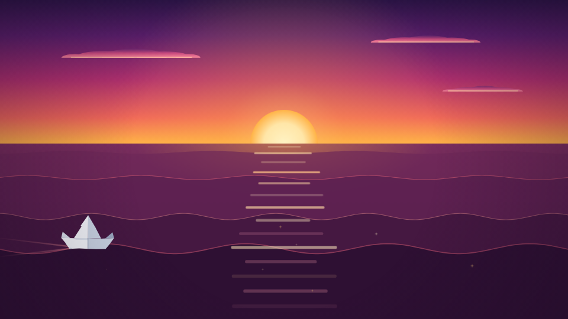
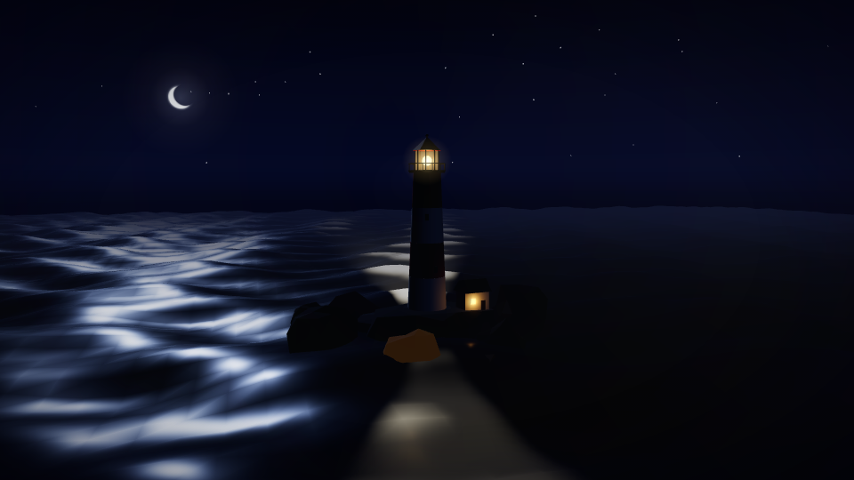

# Claude Animation Studio

An AI animation studio that runs inside Claude Code. You describe an animation, a hidden
director refines your prompt into a detailed brief, and five agents build it together in
2D or 3D.

> **Status:** early development. The director and all five agents work end to end. See the [roadmap](#roadmap).



*"a paper boat sailing across a sunset sea", 2D mode. The agents' full output is in [`examples/paper-boat-2d`](examples/paper-boat-2d).*



*"a lighthouse on a rocky island at night, its beam sweeping over the waves", 3D mode with Three.js. See [`examples/lighthouse-3d`](examples/lighthouse-3d).*

## How it works

```
your prompt ──► Director (hidden) ──► Storyboard ──► Designer ──► Animator ──► Renderer ──► Reviewer
                refines the brief      scenes &       characters,   movement &   working      checks and
                                       timing         colors        keyframes    code         sends fixes back
```

The director's brief and every agent's output are saved next to the finished animation, so you can
see how it was made:

```
animations/2026-11-27T21-40-00-a-paper-boat/
  prompt.txt        what you asked for
  brief.md          the director's refined brief
  storyboard.json   scenes and timing
  design.json       characters, colors and objects
  animation.json    keyframes
  index.html        the finished animation (open it in a browser)
  preview.png       a screenshot from the browser check
  review.json       the reviewer's notes and how many fix rounds it took
```

| Mode | Output |
| ---- | ------ |
| `2d` | An animated SVG/canvas page you can open in a browser |
| `3d` | A Three.js scene (loads Three.js from the jsDelivr CDN, so it needs an internet connection) |

## Install

Requires Node.js 18 or newer and [Claude Code](https://code.claude.com), signed in. The agents run on your
Claude Code login, so no API key is needed.

```bash
git clone https://github.com/ProProgramer123/claude-animation-studio.git
cd claude-animation-studio
npm install
npm run build
```

## Connect it to Claude Code

From the repo folder:

```bash
claude mcp add animation-studio -- node "$(pwd)/dist/index.js"
```

Then start Claude Code and ask for an animation, for example:

> Use the animation studio to make a 3D animation of a paper plane flying through clouds.

Claude Code calls the `create_animation` tool for you. A full run takes a few minutes, since six agents
work one after another. If Claude Code gives up waiting, raise its tool timeout when you start it, for
example `MCP_TOOL_TIMEOUT=900000 claude` (15 minutes).

Animations are saved in an `animations/` folder inside the folder you started Claude Code from.

### Browser check (recommended)

Before the reviewer looks at an animation, the studio can open it in a headless browser. Any errors, and
a page where nothing moves, are passed to the reviewer and sent back to the renderer to fix. It also saves
a `preview.png`. This needs Playwright's Chromium, installed once:

```bash
npx playwright install chromium
```

Without it the studio still works and skips this check.

## Settings

| Environment variable | Default | What it does |
| -------------------- | ------- | ------------ |
| `ANIMATION_STUDIO_OUTPUT_DIR` | `animations` | Where finished animations are saved |
| `ANIMATION_STUDIO_MODEL` | your Claude Code default | Model the agents use, for example `sonnet` or `opus` |
| `ANIMATION_STUDIO_RUNNER` | `claude-code` | `claude-code` runs real agents; `mock` returns canned replies for testing |
| `ANIMATION_STUDIO_BROWSER_CHECK` | `on` | `off` skips the headless browser check |
| `ANIMATION_STUDIO_CHROMIUM_PATH` | Playwright's Chromium | Use a different Chrome or Chromium binary for the check |
| `CLAUDE_CODE_PATH` | `claude` | Path to the Claude Code CLI if it isn't on your `PATH` |

Pass them with `claude mcp add`, for example:

```bash
claude mcp add animation-studio -e ANIMATION_STUDIO_MODEL=sonnet -- node "$(pwd)/dist/index.js"
```

## The `create_animation` tool

| Argument | Type | Default | Description |
| -------- | ---- | ------- | ----------- |
| `prompt` | string | required | What the animation should show |
| `mode` | `"2d"` or `"3d"` | `"2d"` | Which kind of animation to make |

## Development

```bash
npm run dev        # run the server from source with tsx
npm run typecheck  # type-check without building
npm test           # build, run unit tests, then call the tool over MCP with the mock runner
```

### Project layout

```
src/
  index.ts              starts the MCP server on stdio
  server.ts             registers the tools
  tools/createAnimation.ts
  agents/roster.ts      the director and the five agents
  agents/prompts.ts     each agent's instructions, plus 2D/3D guidance
  agents/pipeline.ts    runs the agents in order, with the reviewer's fix loop
  check/                headless browser check (optional Playwright)
  runners/              how agents reach Claude (Claude Code CLI today; add an API-key runner here)
```

## Roadmap

1. ~~Project setup and MCP server~~
2. ~~Hidden director and the five agents~~
3. ~~Real 2D (SVG/canvas) and 3D (Three.js) output, checked in a headless browser~~ (MP4 export later)
4. Example animations, setup docs and a demo GIF

## License

[MIT](LICENSE)
